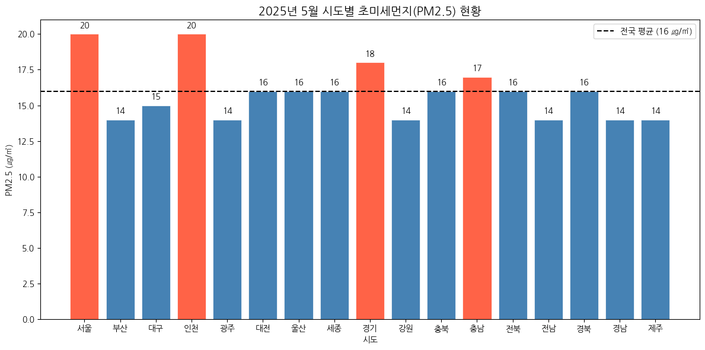

# 우리나라 대기오염 데이터 분석

pandas로 실제 대기오염 데이터를 불러와 정리하고, 그래프로 비교해 본 기록입니다.

---

## 💨 시도별 초미세먼지(PM2.5) 비교

> 에어코리아 2025년 5월 데이터로 시도별 PM2.5를 전국 평균과 비교 *(데이터 정리 · 시각화)*
>
> - 데이터 정리: 엑셀을 불러와 머리글을 건너뛰고, 빈 행 · 불필요한 열 · 숫자가 아닌 주석 행 제거
> - 시각화: 평균보다 높은 곳은 빨간색, 같거나 낮은 곳은 파란색 막대로 나누고 전국 평균선과 수치 표시
> - 한글 폰트: Colab에 나눔고딕을 등록해 한글과 음수 기호가 깨지지 않게 설정
> - 범위: PM2.5만 분석 (SO2, NO2, O3, CO, PM10은 불러오기만 함)
>
> 

> 
결과 그래프

>
> 
>
> 

>
> [노트북 보기 →](./korea_air_quality_analysis.ipynb)

---

## 실행 방법

Google Colab에서 노트북을 열고, [`data/airkorea.xlsx`](./data/)를 노트북과 같은 위치에 올린 뒤 실행합니다.

## 사용 라이브러리

`pandas`, `matplotlib`

## 응용 프로젝트

- [hangang-water-quality](https://github.com/Jenny5789/hangang-water-quality) — 한강 지점별 수질을 pandas로 분석하고 Streamlit 대시보드로 만든 프로젝트
